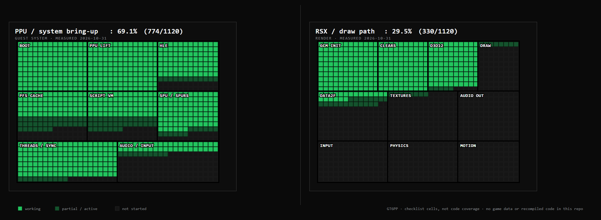

# GT6PP

Gran Turismo 6 (PS3 `BCUS98296` v1.00) **statically recompiled for Windows**. The game runs as a native x86-64 executable — no emulator at runtime.

**Status:** boots, parses the full 857,518-byte `ADCH` boot script, loads UI scripts, and presents a 1280×720 window. **No real draw yet** — the window is black (`draws: 0`).
**Next blocker:** `0x9F44D8` null vcall → K/W2 cache read → first `DATA2F` draw.



*Source: `docs/progress.svg`; rendered PNG is used because GitHub and the app preview do not reliably render the SVG.*

## Run

1. Put your own GT6 disc files under `PS3-Version/Gran Turismo 6 (USA) (En,Ja,Fr)/PS3_GAME/`.
2. Extract `GT.VOL` to `work/gt6_vol/` (not included).
3. From the repo root:

```powershell
$env:GCM_GUEST_FB="0,1280,720,6144"
$env:PPU_STUCKMAX="1000000"
gt6\build\gt6.exe work\bin\EMAIN.elf
```

The console window is the log. The separate 1280×720 window is the game's framebuffer.

## Build

1. Install CMake, Ninja, and [LLVM-MinGW](https://github.com/mstorsjo/llvm-mingw).
2. Clone [ps3recomp](https://github.com/sp00nznet/ps3recomp) into `third_party/ps3recomp`.
3. Run:

```powershell
powershell -ExecutionPolicy Bypass -File scripts\build-gt6.ps1
```

The relift pipeline (`scripts/relift-gt6.ps1`) regenerates `gt6/generated/`.

## Tooling

- `tools/GTToolsSharp/` — GT.VOL listing/extraction.
- Ghidra 10.4 headless + `tools/ghidra_scripts/DecompileAt.java` — targeted PPU/SPU decompilation.
- `tools/ghidra-reverse` / `binary-analysis-patterns` agent skills.
- Details and restrictions: [docs/TOOLING.md](docs/TOOLING.md).

## What works

| Area | State |
|---|---|
| `GT.VOL` | Opens; 4,207 TOC entries, 32,591 files |
| Boot script | Full `ADCH012` parse; 255,264 reads to EOF |
| PPU lift | 75,652 functions; 70,989-function corrected boundary list |
| SPU / SPURS | 15 runtime job images lifted; dispatch returns `rc=0` |
| HLE / threads | 1,216 NID handlers; SPU event-handler crash fixed |
| Present / clears | Flips and `CLEAR_SURFACE` reach D3D12 |
| UI scripts | `MenuClassDefine`, `Prototypes.mwidget`, `cursor.*` load |

## Next up

- Generate or serve `Prototypes.adc` so the UI compiler leaves its null-value loop.
- Submit and render the first `DRAW_ARRAYS` through the D3D12 backend.
- Then textures/fonts, menus, audio/input, performance.

## Legal

This repository contains **code and documentation only**. It does **not** include game data, decryption keys, decrypted executables, or generated recompiled game code. You must own Gran Turismo 6 to use this project. Game names and trademarks belong to their owners.

## License

Original code is MIT-licensed; see [LICENSE](LICENSE). Third-party components keep their own licenses.
